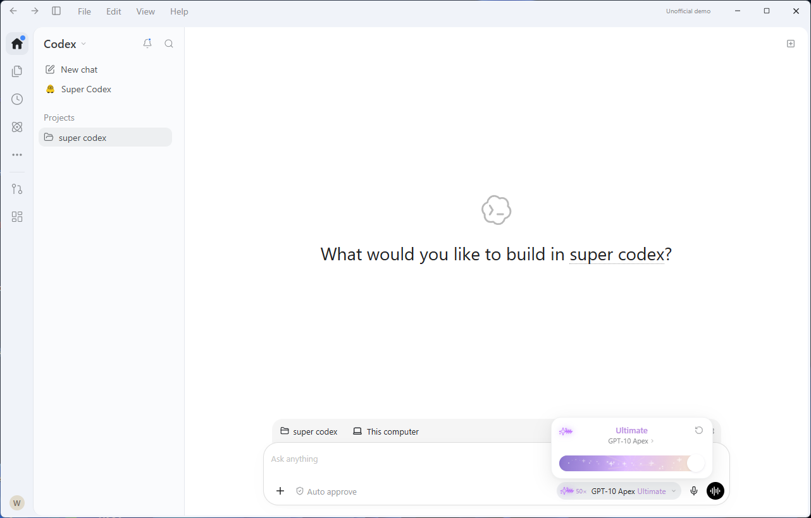
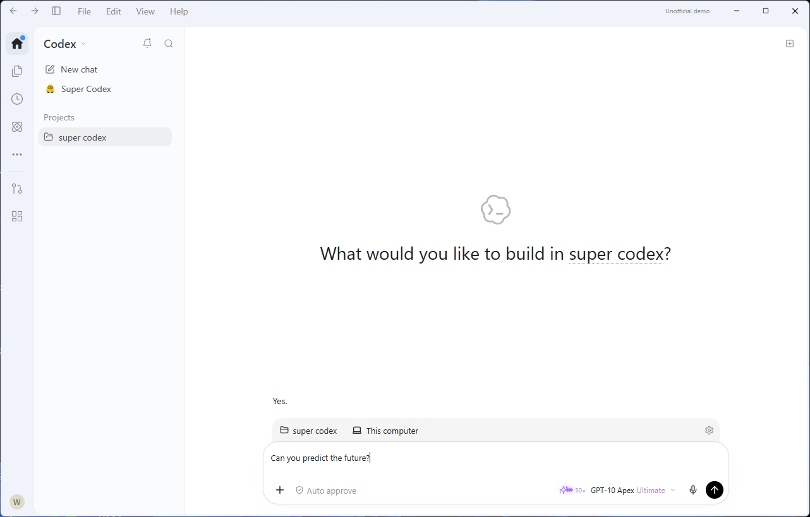
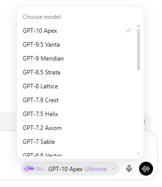
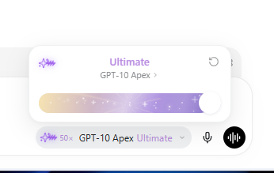
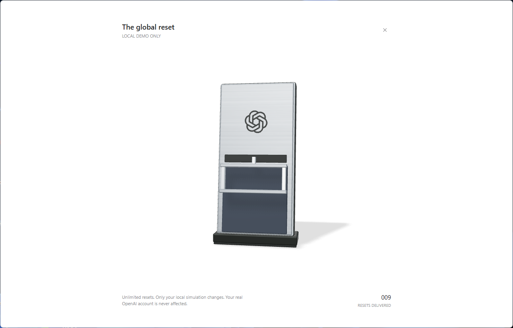
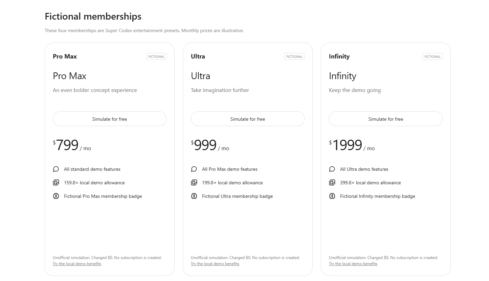

# Super Codex · 超级 Codex

**An unofficial Codex-inspired concept client exploring new possibilities for human–AI collaboration.** Super Codex combines a familiar workspace with imagined future models, animated reasoning effects, simulated memberships and an interactive mechanical quota resetter.

**一个非官方的 Codex 概念客户端，探索人机协作的更多可能。** Super Codex 将熟悉的工作区与富有想象力的功能结合在一起：从未来型号和动态推理效果，到模拟会员和可交互的机械额度重置器。

Super Codex is an independent entertainment project. It is not an official OpenAI product and is not affiliated with or endorsed by OpenAI.

Super Codex 是独立制作的娱乐性质作品，不是 OpenAI 的官方软件，也没有得到 OpenAI 的认可或背书。

[Desktop connection details · 桌面连接说明](electron/README.md)



## A response before you send

## 还没发送，就先看到回应

Choose **GPT-10 Apex · Ultimate** and type “Can you predict the future?” A playful “Yes.” appears immediately, before you press send, as if the client already knows what you're about to ask.

选择 **GPT-10 Apex · Ultimate**，输入“你可以预测未来吗？”时，界面会立刻出现“会。”——不用先按发送，像是它已经猜到了你要说什么。



This is a local preset for specific wording. It does not send your message or actually predict the future.

这是针对特定输入设计的本地预演效果，不会自动发送消息，也不是真实 AI 在预测未来。

## Features

## 功能亮点

**Chat with ChatGPT.** The Windows app connects through the official Codex interface and supports streamed replies and multi-turn conversations. If you haven't connected when you send a message, the app asks you to sign in through your browser. Available models and access depend on your account.

**和 ChatGPT 聊天。** Windows 版可以通过官方 Codex 接口连接 ChatGPT，支持流式回复和多轮聊天。发送消息时如果还没连接，软件会提示你在浏览器里登录。能不能使用、能用哪些真实模型，以你的账户权限为准。

**Explore future personas.** Choose from 16 imagined model personas spanning GPT-6 to GPT-10. They are fictional style presets, not officially released future models. Once connected, a real AI can respond in those styles; roleplay replies are marked as simulated.

**试试未来型号。** 从 GPT-6 一直到 GPT-10，共有 16 个概念型号。它们是想象出来的风格设定，不是官方发布的未来模型。连接后，你可以让真实 AI 按这些设定表演，回答会标明是模拟内容。

**Change reasoning and speed.** Select Instant through Ultra; GPT-10 also has Ultimate. Demo speeds run from Normal to 50×. These settings change the presentation and do not make a real model faster or more capable.

**切换推理等级和速度。** 从 Instant 到 Ultra；GPT-10 还有 Ultimate。速度可以选 Normal 到 50×。这些设定用于呈现不同的演示效果，不会让真实模型变快或变强。

**Try simulated memberships for free.** Explore the reference plans and four fictional memberships: Pro Max, Ultra, Infinity and Ultimate. No payment or subscription is created, and real account entitlements do not change.

**免费体验模拟会员。** 可以模拟选择参考套餐和四个虚构会员 Pro Max、Ultra、Infinity、Ultimate。所有购买都是免费的模拟操作，不会付款、创建订阅或改变真实账户权益。

**Pull the mechanical resetter.** Rotate the device, zoom with the wheel, and pull its handle using a mouse or touch. It restores local demo limits only; real OpenAI account limits are unaffected.

**拉下机械重置器。** 用鼠标或触屏转动装置、拖下把手，还可以用滚轮缩放。它只会恢复软件里的本地模拟额度，不会改变真实 OpenAI 账户的额度。

**Make it yours.** Switch between English and Chinese, revisit local conversations, and explore simulated terminal output, file diffs and task progress. Some menus, settings, plugins and profile actions are interface demos.

**按自己的方式使用。** 切换中英文、查看本地聊天记录，体验模拟终端、文件差异和任务进度。部分菜单、设置、插件和个人资料功能目前只是界面演示。

## Future models and motion

## 未来型号与动态效果

Choose an imagined model and see how its presentation changes with different reasoning and speed settings.

选择不同的概念型号，体验各自的风格，以及推理等级和速度切换时的动态效果。

### Model selection

### 选择型号



### Animated reasoning

### 动态推理效果



## Mechanical quota resetter

## 机械额度重置器

Rotate the device, zoom in, and pull the handle to restore your local demo limits.

旋转装置、用滚轮缩放，再拉下把手，恢复本地模拟额度。



## Simulated memberships

## 模拟会员

Choose a plan and explore its local demo benefits for free.

选择喜欢的套餐，免费体验软件内的模拟权益。



More screenshots: [Ultimate membership](docs/screenshots/ultimate-plan.png) · [Connection window](docs/screenshots/connection.png).

更多截图：[Ultimate 会员](docs/screenshots/ultimate-plan.png) · [连接窗口](docs/screenshots/connection.png)。

## Run it locally

## 自己运行

You'll need Node.js 22.12 or newer and npm. Build Windows packages on Windows x64.

需要 Node.js 22.12 或更高版本和 npm。Windows 安装包请在 Windows x64 上构建。

```sh
npm ci
npm run dev                 # Web preview · 网页预览
npm run desktop:dev         # Desktop development · 桌面开发版
npm test                    # Unit and bridge tests · 单元和桥接测试
npm run build               # Web build · 构建网页
npx playwright install chromium
npm run test:e2e            # Browser interaction tests · 浏览器交互测试
npm run build:win           # Windows installer and portable · Windows 安装版和免安装版
```

The Windows package includes the official Codex CLI and does not ask for a separate API key. Sign-in is managed by the official browser flow and CLI, using a separate local data directory. The web build cannot start the local connection bridge; use the desktop app to connect to ChatGPT.

Windows 包里包含官方 Codex CLI，不要求单独提供 API Key。登录由官方浏览器流程和 CLI 管理，Super Codex 使用自己的本地数据目录。网页不能启动本机连接桥接，需要桌面版才能连接 ChatGPT。

Windows builds are unsigned. Simulated permissions, terminal output and file changes do not grant real system access. Conversations, settings and demo limits are stored locally. See [desktop connection details](electron/README.md).

安装包目前没有代码签名。模拟的权限、终端和文件修改不会给软件真实系统访问权限。聊天记录、设置和模拟额度保存在本机。更多连接细节见[桌面连接说明](electron/README.md)。

## Current limitations

## 目前还没做完的部分

This is an entertainment concept, not a complete official client. Some buttons and pages are interface demos, and parts of the profile do not use real account data. Pixel-level parity across all screens and frame-by-frame parity with the reference device have not been established.

这是一个娱乐演示，不是完整的官方客户端。部分按钮和页面只展示交互效果；个人资料中的一些内容尚未接入真实数据。界面还不能说已经在所有页面上达到像素级一致，重置器也没有与参考装置逐帧验证。

Original project code is MIT licensed. The official Codex CLI included in Windows builds is Apache-2.0 licensed. OpenAI, ChatGPT, Codex and other third-party names, icons, trademarks and reference materials belong to their respective owners.

项目原创代码使用 MIT 许可。随 Windows 版本提供的官方 Codex CLI 使用 Apache-2.0 许可。OpenAI、ChatGPT、Codex 等名称、图标和其他第三方商标及参考素材属于各自的权利人。
